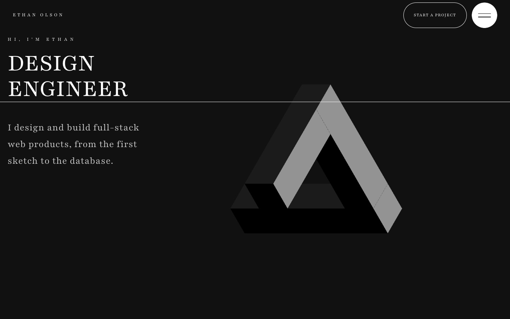

# Ethan Olson | Concept Portfolio

> **Work in progress.** The full-stack features are being built in the open. See the
> [roadmap](#roadmap).

[](https://github.com/al-xpro/portfolio-project/actions/workflows/ci.yml)

A portfolio for **Ethan Olson, a fictional design engineer**, designed and
developed by [AlxPro](https://alxpro.com). It's a concept build: the persona, works and
copy are invented to show how a motion-rich, full-stack portfolio is made.

**Live:** not deployed yet. It will be published at `ethanolson.alxpro.com`.



## What it does

- Pages: home, about, services, works with a page per project, contact, privacy, terms
  and a 404 page
- A real-time 3D optical illusion in the hero, in black metal, that turns into place on load
- Original GSAP scroll scenes on every page: a zoom grid, a mask reveal over video, a
  testimonials deck, a sticky services timeline with diagrams built in code, a cursor
  preview for the works, a framed cover parallax per project, and a sticky reveal footer
- A contact form with a shared Zod schema, live validation and a server action that works
  without JavaScript, next to an availability calendar that shows different free days
  every month (generated from the month, no booking service)
- Full `prefers-reduced-motion` support: every scene has a static fallback
- Accessible navigation: real links and buttons, a focus trap, Escape to close, visible
  focus on every control
- SEO: metadata, canonical URL, generated Open Graph image and icons, JSON-LD,
  `robots.txt`, `sitemap.xml` and `llms.txt`

## Tech stack

- [Next.js 16](https://nextjs.org) (App Router, statically prerendered) and React 19
- TypeScript and Tailwind CSS 4
- GSAP + ScrollTrigger for scroll scenes, Lenis for smooth scrolling
- React Three Fiber, drei and three.js for the 3D hero
- Zod for validation, Vitest and Playwright for tests

Coming next (see the roadmap): Storyblok, Neon Postgres with Drizzle, Resend and Vercel
BotID for the contact flow, Umami and self-built Web Vitals.

## Architecture

```text
app/                  routes, metadata, icons, OG image, robots, sitemap
components/sections/  the home page sections
components/pages/     one view per page (services, works, about, contact, legal, 404)
components/ui/        shared UI (header animation, navbar, footer, diagrams, 3D figure)
components/providers/ smooth scrolling (Lenis)
content/              all copy and media paths, one file per page
lib/                  GSAP setup, animation helpers, media-query hooks
```

Pages are Server Components that render client sections. All scroll animation runs
through `lib/gsap.ts`, inside `gsap.matchMedia()`, so it's skipped when the visitor
prefers reduced motion. Copy and media paths live in `content/`, so the planned CMS
replaces one layer.

## Getting started

Requires Node.js 20.9 or later.

```bash
npm install
npm run dev        # http://localhost:3000
npm run typecheck
npm run lint
npm run build
npm test           # unit tests (Vitest)
npm run test:e2e   # end-to-end tests (Playwright, builds the site first)
```

### Environment variables

Put them in `.env.local`. Names only here. Never commit values.

| Name | Purpose |
| --- | --- |
| `NEXT_PUBLIC_SITE_URL` | Canonical URL for metadata, sitemap and robots. Defaults to `https://ethanolson.alxpro.com`. |

## How this was built

First version built from January to March 2026; cleaned up and published as `v1.0` in
October 2026 (the clean-up was done with Claude Code); new features developed in the open
since. Built with an agentic workflow: I write issues as specs, agents open the pull
requests, and I review and merge every change.

## Roadmap

[Open issues](https://github.com/al-xpro/portfolio-project/issues) and the
[`v2.0 — Full stack` milestone](https://github.com/al-xpro/portfolio-project/milestones).

## Contributing

Issues are welcome. See [CONTRIBUTING.md](CONTRIBUTING.md), the
[code of conduct](CODE_OF_CONDUCT.md) and the [security policy](SECURITY.md).

## Credits and license

Media sources are listed in [CREDITS.md](CREDITS.md).

© Alex Prostamo. All rights reserved. The code is public so it can be read and reviewed.
It is not licensed for reuse or redistribution. See [LICENSE](LICENSE).
